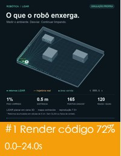
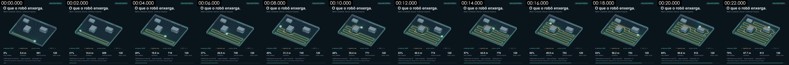
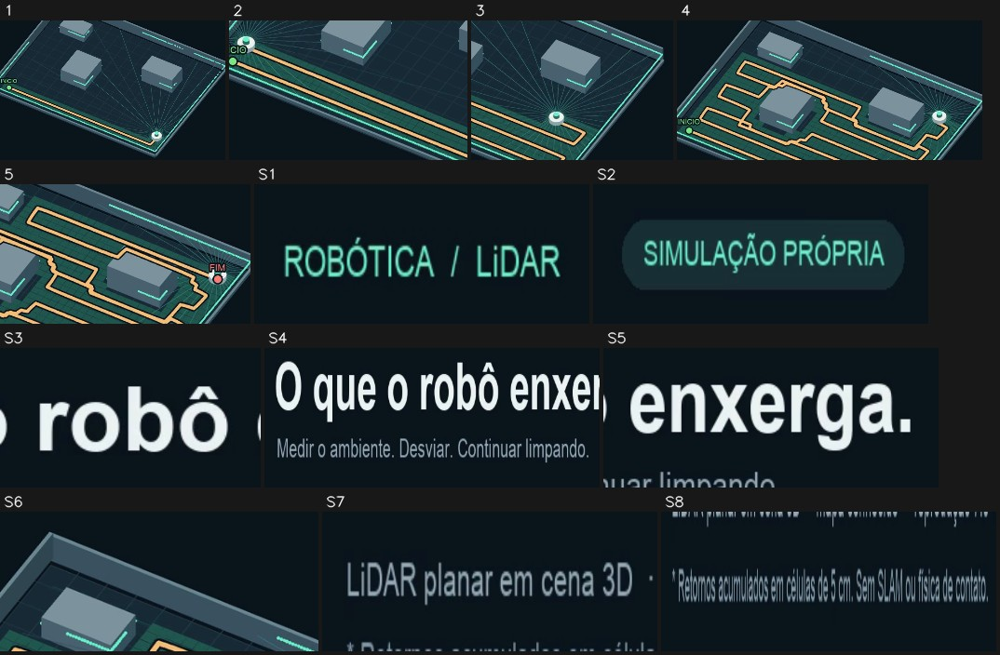
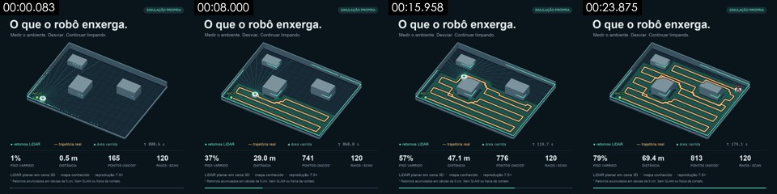

# Análise do vídeo: lidar_ptbr.mp4

**Veredito**: render por código / template 100%

- 24.0s · 1080×1080 · 24.0fps · 1:1; 1 plano(s), média de 24.0s; transições: —
- Confiança (ponderada pela duração) 72%; decidido por: só forense determinística; Sem VLM; filmagem real / IA / 3D são separados só por estatísticas de pixel, então a confiança é limitada. Um agente que enxerga imagens: rode rea-video review, olhe cada plano e mescle com apply-review; caso contrário, configure um VLM (qualquer modelo multimodal compatível com OpenAI, ex.: Gemini / GPT-4o / Doubao / Qwen-VL): defina REA_VLM_BASE_URL, REA_VLM_API_KEY e REA_VLM_MODEL (vários modelos separados por vírgula servem de fallback) e rode de novo com --vlm
- Remake: render em código / captura de tela 1 plano → 1 projeto de código (veja “Plano de remake”)

<!--mix-->

| Imagem base | Duração | Proporção |
|---|---|---|
| render por código / template | 24.0s | 100% |

## Conteúdo e estrutura

- Sem resumo do vídeo inteiro (precisa do VLM ou de um agente assistindo ao vídeo completo); o texto das legendas está em “Camada de finalização”

## Elenco, cenários e objetos de cena

- Nenhum elenco extraído (precisa da passada do VLM no vídeo inteiro, ou de um agente preenchendo `cast` no nível superior de `review_answers.json`)

## Som

- Sem trilha de áudio

## Câmera, luz e montagem

- Edição: 0.0 cortes por minuto, plano médio de 24.0s; nenhum plano real

- Nota: razão de iluminação, luz suave / dura, temperatura de cor e tamanho do plano são medidos nos pixels do assunto (o rosto quando existe; senão a região em foco, que é uma estimativa); a compressão das plataformas esmaga as sombras, então dureza e preenchimento saem conservadores; ângulo de câmera, fonte de luz, reflexo nos olhos e contraluz seguem os leitores de imagem. Quando medição e leitores divergem, os dois são listados.

## Camada de finalização (legendas / letreiros estilizados / stickers / efeitos sonoros pontuais)

- texto estilizado ×3 (preenchimento verde, multicolorido / gradiente, contorno grosso, preenchimento marrom, preenchimento ciano): "INiCIO", "— trajetoria r", "FIM"
- título ×4: "SIMULACAOPROPR", "ROBOTICA LiDAR", ") que o robo e", "Mediro ambient"
- rótulo de texto ×22: "●retornos LiDA", "t027.8s", "area varrida", "DISTANCIA", "PISOVARRIDO", "PONTOSUNICOS*" …
- contador ×56: "2%", "1.2 m", "262", "120", "4.0 m", "519" …
- Nenhum texto sobreposto ou sticker detectado
- Exportações: `packaging/overlays.ass`, `packaging/timeline.json` (SRT é a timeline das legendas; ASS traz cor, contorno, posição e animação de entrada, troque pela fonte original; timeline.json é a timeline completa)

Remake: grave as legendas e os letreiros estilizados com `packaging/overlays.ass` (ffmpeg -vf ass=overlays.ass) ou refaça a partir do timeline.json no CapCut / Remotion; stickers e GIFs precisam de assets equivalentes (bancos de memes / GIFs), os recortes estão em packaging/.

## Plano de remake

**render em código / captura de tela 1 plano → 1 projeto de código**

### Composição em código

Um projeto Remotion / HTML refeito a partir das trilhas de texto e do layout (texto e UI 100% controláveis; mudar o texto é mudar os dados). Um LLM pode escrever esse projeto diretamente.

- Parte 1: planos #1 (0.0 a 24.0s)

Assets do remake (todos na pasta do relatório; entregue junto com os dados abaixo para quem for escrever o código, ou para um LLM):
- `shots/shot_XXX_first.jpg` / `_last.jpg`: primeiro / último quadro de cada plano em tamanho real, para layout, tamanho da fonte e margens
- `shots/shot_XXX_strip.jpg`: quadros-chave a cada 0,5 s aproximadamente, para acompanhar a animação
- `shots/shot_XXX_elements.jpg` e `_el_NN.jpg` / `_st_NN.jpg` / `_ly_NN.jpg`: recorte em tamanho real de cada elemento já assentado, numerado como na timeline de movimento; redesenhe as formas a partir deles, recorte ícones, logos e ilustrações que não dá para redesenhar
- `packaging/overlays.ass`, `packaging/timeline.json`: tempo, posição e cor do texto

Como construir as imagens (pelo tipo de imagem medido):
- gráfico de dados: Escalas SVG / D3 para eixos e marcas, números contando com interpolate(), barras / linhas crescendo com spring()

| Plano | Tempo | Construção | Imagem | Câmera | Cores | Texto na tela |
|---|---|---|---|---|---|---|
| #1 | 0.0–24.0s | gráfico de dados | (a preencher a partir das imagens: o que os elementos formam e como se movem) | estático | fundo #08151c · #24504a #203a40 #15262f #4b6964 | ROBOTICA/LiDAR / SIMULACAO PROPRIA / SIMULACAOPROPRIA /  que o robo enxerga. / Mediro ambiente.Desviar.Continuarlimpando. / ) que o robo enxerga. |

Timeline de movimento por plano (medido: posições em % da largura / altura do quadro, cores amostradas quando o elemento se assenta; leia junto com a tira de quadros-chave)

Movimento #1 0.0–24.0s · 5 eventos

- Fundo #08151c; outras cores principais #24504a #203a40 #15262f #4b6964
Recortes dos elementos (os números batem com a lista de movimento abaixo; L = a camada em movimento contínuo no meio e no fim do plano, S = elementos que nunca se movem), arquivos em tamanho real em `shots/`:

- S1. nunca se mexe: shape / text block · x 5% a 24%, y 3% a 7% · #366b65 · texto “ROBOTICA/LiDAR” · [recorte](shots/shot_001_st_01.jpg)
- S2. nunca se mexe: shape / text block · x 73% a 95%, y 3% a 7% · #326c65 · texto “SIMULACAO PROPRIA / SIMULACAOPROPRIA” · [recorte](shots/shot_001_st_02.jpg)
- S3. nunca se mexe: shape / text block · x 27% a 41%, y 9% a 16% · #d8e2e4 · texto “ que o robo enxerga. / ) que o robo enxerga. / O que o robo enxerga.” · [recorte](shots/shot_001_st_03.jpg)
- S4. nunca se mexe: shape / text block · x 5% a 55%, y 11% a 20% · #737c81 · texto “ que o robo enxerga. / Mediro ambiente.Desviar.Continuarlimpando. / ) que o robo enxerga.” · [recorte](shots/shot_001_st_04.jpg)
- S5. nunca se mexe: shape / text block · x 42% a 66%, y 11% a 17% · #dbe6e7 · [recorte](shots/shot_001_st_05.jpg)
- S6. nunca se mexe: shape / text block · x 32% a 63%, y 21% a 33% · #3a5260 · [recorte](shots/shot_001_st_06.jpg)
- S7. nunca se mexe: horizontal line · x 5% a 29%, y 89% a 92% · #3e4c56 · texto “LiDARplanaremcena3D / LiDAR planar em cena 3D / LiDARplanar em cena3D” · [recorte](shots/shot_001_st_07.jpg)
- S8. nunca se mexe: horizontal line · x 5% a 62%, y 92% a 94% · #3c4b56 · texto “LiDARplanaremcena3D / mapaconhecido·reproducao7.5x / *Retornos acumulados em celulas de5 cm.SemSLAM ou fisica decontato.” · [recorte](shots/shot_001_st_08.jpg)
1. 0.07–1.40s · meio (x 18% a 84%, y 31% a 71%) · changes, se desdobra rightward (desenho / crescimento / wipe), linear · #23514b · texto “INiCIO” · [recorte](shots/shot_001_el_01.jpg)
2. 1.87–2.93s · meio (x 20% a 60%, y 44% a 67%) · changes, se desdobra leftward (desenho / crescimento / wipe), linear · #21524b · texto “INiCIO” · [recorte](shots/shot_001_el_02.jpg)
3. 4.73–5.93s · meio (x 47% a 87%, y 38% a 64%) · changes, se desdobra rightward (desenho / crescimento / wipe), linear · #215049 · [recorte](shots/shot_001_el_03.jpg)
4. 16.20–20.07s · meio (x 18% a 84%, y 27% a 55%) · changes, se desdobra rightward (desenho / crescimento / wipe), ease-in-out · #23534c · texto “INiCIO” · [recorte](shots/shot_001_el_04.jpg)
5. 21.07–23.27s · meio (x 42% a 84%, y 31% a 53%) · changes, se desdobra rightward (desenho / crescimento / wipe), linear · #21524b · [recorte](shots/shot_001_el_05.jpg)

## Decupagem

| # | Tempo | Duração | Imagem base | Material | Sobreposições | Câmera | Imagem | Remake |
|---|---|---|---|---|---|---|---|---|
| 1 | 00:00.000 | 24.00s | render por código / template 72% | renderizado pelo criador | — | estático | — | render por código · Parte 1 |

## Pontos em aberto

- Nada precisa de uma segunda olhada

## Apêndice

### Plano a plano

Evidências, probabilidades, trilhas de texto e prompts por plano. Recolhido por padrão.

#1 00:00.000–00:24.000 · render por código / template

- Probabilidades: render por código / template 72%, gravação de tela / captura de tela 10%, vídeo gerado por IA 8% (deterministic)
- Material: renderizado pelo criador
- Textura renderizada: 61% de blocos de cor chapada, 95% dos pixels usam só 34 cores, 14% de bordas alinhadas aos eixos
- Detalhe fino e denso de alta frequência sobre fundo chapado (texto pequeno / UI), parece captura de tela ou documento
- Trilha de texto (texto na imagem/bottom): ●retornos LiDAR / —trajetoria real / area varrida / t 001.6 s
- Trilha de texto (texto na imagem/bottom): 2% / 1.2 m / 262 / 120
- Trilha de texto (texto na imagem/bottom): LiDARplanaremcena3D / mapaconhecido·reproducao7.5x / *Retornos acumulados em celulas de5 cm.S / LiDAR planar em cena 3D
- Trilha de texto (texto na imagem/middle): INiCIO / FIM
- Remake: Render por código: reconstrua em Remotion / HTML a partir das trilhas de texto e do layout, 100% controlável, sem precisar de modelo generativo

### Pistas nos metadados

- Encoder: `Lavf63.1.102`

### Observações

- A análise forense determinística é confiável para movimento, pan/zoom do quadro inteiro, textura renderizada e conversão de 24→30 fps; distinguir live action de IA e de 3D depende do VLM e da revisão humana.
- A transcodificação das plataformas costuma remover os metadados; a ausência de metadados não prova nada.
- Os dados completos estão em `breakdown.json`; agentes leem a versão compacta com `rea-video summary`.
